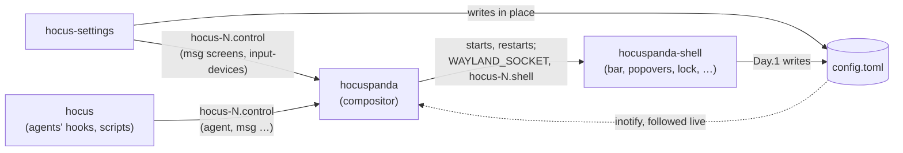

# Architecture

What runs, how the pieces talk, and which crate owns what. The why is in
the [decisions](decisions/) (0001 Rust and smithay, 0002 licences, 0003
the shell as a client, 0005 the shell's widgets, 0006 the words) and
[design/tech-choices.md](design/tech-choices.md); each surface's
behaviour is in its spec under [design/](design/).

## Processes

- **The compositor** (`hocuspanda`, crate `hocus-compositor`): the
  session. Window management, rendering (GLES, or pixman), input, the
  Wayland protocols, XWayland, the lock, captures, screen sharing
  (PipeWire), idle, and the D-Bus services of the portal (`ScreenCast`,
  `Settings`) and `org.freedesktop.ScreenSaver`. It starts every other
  program and hands them `HOCUS_SOCKET` and `HOCUS_CONFIG`.
- **The shell** (`hocuspanda-shell`, crate `hocus-shell`, iced on
  layer-shell): every surface the desktop draws itself: the bar and its
  popovers, the launcher, the notifications (it serves
  `org.freedesktop.Notifications`), the tray (`StatusNotifierWatcher`),
  the lock screen's and the polkit dialog's interface, captures' toolbar,
  the clipboard's history, the emoji picker. Started from beside the
  compositor's binary, restarted when it ends; the windows stay.
- **The Settings** (`hocus-settings`, iced, an ordinary window): one at a
  time (a socket in `XDG_RUNTIME_DIR`); they write the configuration file.
- **`hocus`** (crate `hocus-cli`): one line to the control socket per
  call; what agents' hooks run, and `hocus msg …` for people and tests.

### Sockets and protocols

| Line | Path | Format | Crate |
|---|---|---|---|
| Wayland, shell | `WAYLAND_SOCKET`, a connection the compositor made | standard protocols (wlr-layer-shell for every shell surface) | smithay / iced_layershell |
| Shell's line | `<wayland socket>.shell` (`HOCUS_SHELL_SOCKET`) | one JSON object a line, `{"kind":…,"data":…}`, after a hello naming the protocol's version; facts and requests, never a question the loop waits on | `hocus-link` (`ToShell`, `ToCompositor`, `wire`) |
| Control socket | `<wayland socket>.control` (`HOCUS_SOCKET`) | one line of words: `agent …` reports, `msg idle\|lock\|outputs\|input-devices [follow]\|a11y`, `msg shell status\|restart`, the Settings' `msg screens`; `mcp NAME` opens an agent's line of JSON objects (docs/design/mcp.md) | `hocus-agents` (`Report`, `Question`, `ProgramAsk`, `mcp`) |
| Configuration | `$XDG_CONFIG_HOME/hocuspanda/config.toml` (`HOCUS_CONFIG`) | TOML, edited in place; defaults in `packaging/config.toml` | `hocus-config` |
| D-Bus | the bus `--session-bus` names (or the session's, on a virtual terminal), the system bus | freedesktop interfaces | zbus in each crate |

## Crates

| Crate | Owns | Depends on (ours) |
|---|---|---|
| `hocus-compositor` | the `hocuspanda` binary, its `State`, and the in-process test harness (`Headless`) | config, geometry, link, pandas, words, panic, agents, xdg, perf |
| `hocus-shell` | the `hocuspanda-shell` binary, its surfaces and the widget kit (`src/ui`) | words, link, pandas, panic, a11y, xdg, day, sound, bluetooth, network |
| `hocus-settings` | the `hocus-settings` binary: its model of every setting, its pages | words, config, agents, link, pandas, panic, perf, geometry, sound, bluetooth, network, xdg |
| `hocus-cli` | the `hocus` binary (`hocus mcp` among its commands) | agents, panic, day, perf, xdg |
| `hocus-link` | the shell's line: its messages, wire and version; the surfaces' namespaces and the measures both sides draw by; the theme's tokens | words |
| `hocus-agents` | the control socket's lines; agents' states, the tools' hooks, plugging tools in, herdr, a process's ancestry | link |
| `hocus-config` | the configuration file read and written in place; every default (`defaults`, from `packaging/config.toml`) | — |
| `hocus-words` | `Lang` and the words catalogue (`words/*.toml`, generated) | — |
| `hocus-day` | "Your day": calendars and tasks behind adapters, read by workers | config |
| `hocus-pandas` | the pandas' drawings and their motion | — |
| `hocus-geometry` | rectangles, snap zones, magnetic edges (the compositor's and the Settings' trial area alike) | — |
| `hocus-xdg` | desktop entries, icons, `mimeapps.list`, autostart | — |
| `hocus-a11y` | screen readers: trees handed to AT-SPI through AccessKit | — |
| `hocus-perf` | a day of CPU and memory: recorded, read back, said | words |
| `hocus-panic` | the panic hook every program installs | — |
| `hocus-sound` | PipeWire, through its own tools | — |
| `hocus-network` | NetworkManager and rfkill | — |
| `hocus-bluetooth` | BlueZ | — |

Only `hocus-compositor` depends on smithay; only the shell and the
Settings on iced. The library crates draw nothing and run no loop of
their own: the system ones (`sound`, `network`, `bluetooth`, `day`) run
their work on threads and hand back owned values through a callback or a
channel. One crate is vendored with a patch, `iced_tiny_skia`
([vendor/README.md](../vendor/README.md)).

## Where state lives

- **The compositor**: one `State`, owned by the calloop loop, grouped by
  concern (`src/state/`: frames, input, menus, protocols, windows) beside
  the features' own modules; its window model is `src/model.rs`.
- **The shell**: each surface's state is a value of its own, a field of
  `Shell`, changed by messages and viewed as a function of it
  (`src/surfaces.rs`, #773; not every surface has moved yet). A surface
  built on the kit declares its controls once; hit-testing, the keyboard's
  ring, screen readers' nodes and the tests' dump come from that tree
  (decision 0005).
- **On disk**: the configuration (the user's); under
  `$XDG_STATE_HOME/hocuspanda/` the clipboard's history, `tasks.json`,
  the recent emoji, `screen-sets`, `day-sources`, `perf/`, and the
  Settings' `config.last-good.toml` and `settings-recent`; the day's
  caches under `$XDG_CACHE_HOME/hocuspanda/day`. The clipboard's key is
  in the keyring of the bus the compositor names, else in a `0600` file
  beside the history (`clipboard.key`).

## The event loop

The rules in [CLAUDE.md](../CLAUDE.md), "Hard rules", in short: the
compositor's state belongs to its loop and is never shared across
threads; nothing blocks the loop (I/O, D-Bus, processes run on threads
and send owned results back through calloop channels); no work is queued
per animation tick; no panic on the loop. Monotonic time for everything
but what the user reads. The shell and the Settings follow the same rules
on iced's loop: their workers talk to the system, their views only read.
A motion both sides draw (the bar's form switch) is computed by each from
the same start on `CLOCK_MONOTONIC`, with no message per frame.

## Where to read next

[CLAUDE.md](../CLAUDE.md) (commands, tests), [workflow.md](workflow.md)
(builds, CI, the development loop), [performance.md](performance.md)
(budgets, the GPU rule), [agents.md](agents.md), and the specs:
[bar](design/bar.md) (with "The shell's widget kit"),
[settings](design/settings.md) (with "Words"),
[windows](design/windows.md), [lock](design/lock.md),
[notifications](design/notifications.md), [sharing](design/sharing.md),
[screen-reader](design/screen-reader.md).
