# Spike: the bar drawn with iced (issue #315)

Status: report, 2026-10-28. It answers the seven points of the spike in
[tech-choices](tech-choices.md). The code is throwaway:
[crates/bar-spike](../../crates/bar-spike/) (one file,
`src/main.rs`) and the scripts used for the measurements
(`crates/bar-spike/scripts/`).

## Verdict

| # | Point | Verdict | In one line |
|---|---|---|---|
| 1 | Full form, partly | **Go, with fixes** | Close to the board once three traps are avoided. At rest it draws once a second, but it damages the whole surface, not the clock's region |
| 2 | Popover and cone | **Go** | Never closed on the way; closes 301–302 ms after the pointer left. Esc closes. The keyboard goes back to the window, not the bar: that is the compositor's job |
| 3 | Text field | **Go for caret, selection and placeholder; IME not tested** | The first build's compositor cannot do IME for a layer surface. The client side is there |
| 4 | Halo, wave, form switch | **API go; smoothness not proven** | 600 ms and 240 ms with the exact curves, 29 and 14 frames. Every run fell back to software Vulkan, so GPU timings are still missing |
| 5 | Restart | **Go** | Back on screen in 289–331 ms, windows kept. The windows jump while the bar is down: that is compositor work |
| 6 | Accessibility | **No-go as is; cost known** | iced 0.14 has no AccessKit. Adding our own tree is about a week for the bar and popovers |
| 7 | Blur behind the bar | **Not built (as asked); 5–8 days** | Compositor work whichever toolkit we pick; one client-side snag in iced_layershell |

**Recommendation: keep iced**, with three conditions:

- measure point 4 on a GPU before the first slice;
- budget the AccessKit work (point 6) or decide to defer it;
- pin and watch iced_layershell.

egui would mostly win on point 6. It would lose on what the spike shows iced does well: the look against the mockup, the Animation API, styles we fully control. It would also need its own layer-shell integration. Details and risks are at the end.

## How it was run and measured

- **Client:** `bar-spike`, an `iced_layershell::daemon` with iced 0.14.0 and iced_layershell 0.19.1 (the latest on crates.io, both MIT).
  - The bar surface is anchored right, top and bottom, 248 px wide: the bar's 196 px, 8 px to the screen edge, and 44 px on the left for the halo's outer glow.
  - Its input region is only the bar and the edge strip, so clicks in the glow's room reach the windows.
  - The popover is a second layer surface (overlay layer) created on click.
- **Compositor:** the first build's `hocuspanda --backend headless --output 1920x1080 --api-permission test --no-shell`.
  - It ran in a fresh `/tmp/hp-XXXX` runtime dir with a fresh HOME and XDG dirs, no session bus, and idle locking off in its own fresh configuration.
  - One `foot` window was open.
  - Input and screenshots went through `hocus msg` (`pointer-move`, `click`, `key`, `screenshot`, `stats`, `windows`).
  - Once, it ran nested (`--backend winit`) for a look.
- **Clocks:** the headless binary runs on the **real monotonic clock**, not the tests' virtual clock. Its frame timer fires 16.7 ms after something changes, so a client that redraws every frame gets a frame about every 21–23 ms, not 16.7 ms. That is the backend's pacing, not the client's.
- **What was counted:**
  - The bar's draws: a 1 px canvas counts each draw, and `BAR_TRACE=1` logs it with its time since the process started.
  - Its commits and damage: `WAYLAND_DEBUG=1`.
  - The compositor's frames: `stats`.
  - CPU: `/proc/<pid>/stat` and per-thread `/proc/<pid>/task/*/stat`.
  - Memory: `VmRSS`.
- **The mockup side:** the canvas's `Bar.dc.html`, rendered statically by headless Chrome at 100 %. It used the same fonts and pandas, on the compositor's desktop colour (`scripts/mock.py`, `scripts/shoot.sh`). In every comparison image the mockup is on the left and iced on the right.
- **Builds:** debug and release, Rust stable. Timings are from the release build unless stated.

**The GPU caveat**, which matters for points 1 and 4: the first build's compositor advertises no `zwp_linux_dmabuf_v1` (and no `wl_drm`), neither headless nor nested. Without it, no GPU Vulkan driver can present on Wayland, so wgpu fell back to **lavapipe**, Mesa's software Vulkan running on 22 threads. Its frames reach the compositor through `wl_shm`. All CPU and memory numbers below are therefore worst cases.

I tried to build smithay's `anvil` (MIT), which has dmabuf, to run the bar on the GPU nested. The permission system refused to build code fetched from outside, so the GPU numbers remain to be taken; see "Not tested".

## 1. The full form, partly

**What:**

- The clock: `HH:MM` in Unbounded 400 38 px, the seconds in Unbounded 300 15 px, the date in Manrope 13 px.
- The meeting card.
- The agents group: header, three tiles with their panda (48×46) and count, and the waiting and stuck lines.
- The battery gauge with its time left.

Colours, radii and gradients come from the board's inline styles and section 13 of the spec.

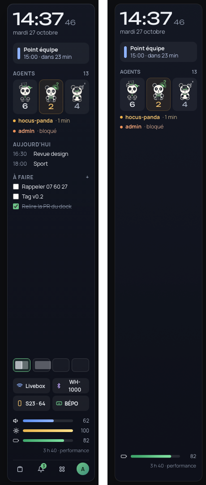

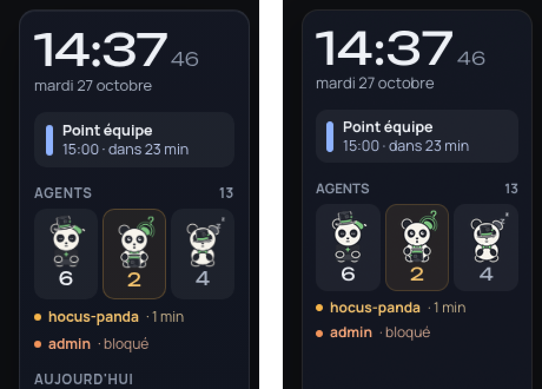

**Three traps, each of which made it look clearly worse until fixed:**

1. **Linear blending.**
   - With iced's default features turned off, every translucent white was about twice as bright as in the browser. A tile at `rgba(255,255,255,0.05)` came out at (70,71,76) instead of (31,34,45). The cause is that iced blends in linear light.
   - The `web-colors` feature blends as browsers do. With it, the bar matches within one level: bar (19,23,34) against (19,22,33), tile (31,34,45) against (30,34,44).
   - Keep `web-colors` on.
2. **Shrunk images alias.**
   - iced samples images bilinearly without mipmaps, so a 472 px panda drawn at 48 px is jagged, with dotted outlines.
   - Copies pre-scaled with Lanczos at the output's pixel size (48 and 96 px) look like the browser's.
   - The figure shows the mockup, the raw image in iced (before the blending fix), and the pre-scaled image in iced. In the product, the pandas need one asset per scale, or a vector drawing (the tech choices already say vector).

   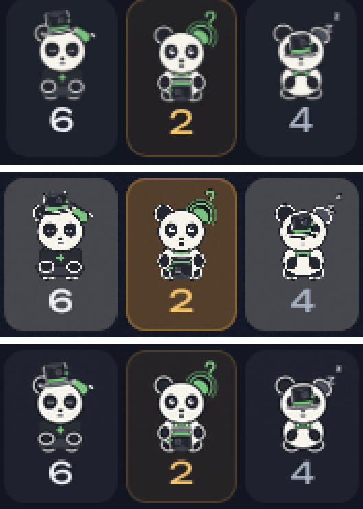
3. **The variable Manrope never matched.**
   - Every Manrope text silently fell back to the system's sans (DejaVu), which is wider and heavier. The variable font's default instance is ExtraLight 200.
   - Static instances made with fontTools' instancer (400, 600 and 700) match. The variable Unbounded works, since its default is 400.

**What still differs:**

- **No letter-spacing in iced's text.** The clock lacks its −0.02 em, so it is about 3 px wider. The uppercase headers lack their +0.06 em.
- **No baseline alignment in rows.** The seconds are bottom-aligned, with 3 px computed from Unbounded's descender; they sit 1–2 px low.
- **No ellipsis.** iced 0.14 has no "…" for overflowing text. A long meeting title is cut, or wraps.
- **Vertical rhythm.** Line heights differ from CSS, so everything sits a few px higher than on the board.
- **No backdrop blur** (point 7). On the headless compositor's flat dark desktop this does not show; over windows it will.
- **iced has no inset shadow**, no rounded clipping of children and no group opacity, so the halo and the cross-fade are drawn by hand (point 4).
- **iced has no keyboard focus for buttons.** It focuses only text inputs, so the bar keeps its own focus ring. Tab cycles it; Enter on the gauge opens the popover.

**At rest:**

| Measure | Value |
|---|---|
| The bar's draws in 30 s | 30 (once a second, on iced's `time::every`) |
| Compositor frames in 30 s | 30 |
| Damage per commit | **whole surface**: `damage_buffer(0, 0, INT_MAX, INT_MAX)` with wgpu, `(0, 0, 248, 1080)` with tiny-skia |
| CPU, wgpu on lavapipe | 1.1 s in 30 s (3.7 %) |
| CPU, tiny-skia | 0.19 s in 20 s (1 %) |
| Memory, wgpu on lavapipe | 300 MB RSS, 117 threads |
| Memory, tiny-skia | 17.6 MB RSS, 24 threads |

Spec section 12 asks to draw "only the clock's region". iced draws only what changed internally, but both renderers present the whole surface, so the compositor redraws all 248×1080 px every second. Damaging only the clock's region needs a patch in iced_wgpu's present path (and in softbuffer's, for tiny-skia). It costs little, but it is not what the spec says.

**Go**, with `web-colors`, pre-scaled pandas and static font instances.

## 2. The popover

**What:**

- A click on the battery group opens a 280 px popover on the overlay layer, aligned with the group's bottom.
- Its surface is 288 px wide: the 8 px on the bar's side are transparent but take the pointer, so there is no gap between the bar and the popover to fall into.
- An explicit state machine keeps it open: `Inside`, then `Aiming { until }`, then `Leaving { until }`.
  - `Aiming` means each move stays in the triangle from the previous pointer position to the popover's near corners, widened by 2 px.
  - Each move toward the popover renews a 300 ms deadline.
  - `Leaving` keeps its first deadline.
- The cone lies entirely over the bar's own surface, since the popover's near edge is the bar's left edge. So every move in the cone reaches the bar.

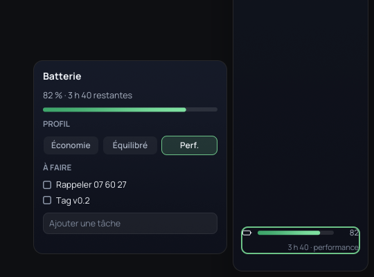

**Scenarios** (driven with `scripts/drive.py`, times from the bar's trace):

| Scenario | Result |
|---|---|
| Diagonal from the gauge into the popover, 20 moves 16 ms apart, across the bar's other content | `Inside → Aiming → Inside`; never closed |
| Straight up, out of the cone | `Leaving`, closed **301.5 ms** later |
| Out of the item for 150 ms, then back | `Leaving → Inside`; stayed open |
| Half way toward it, then still | closed **300 ms** after the last move toward it |
| Across onto the foot window | closed **301 ms** after leaving the bar; gone when checked at 500 ms |
| Jump straight onto the popover and stay | stays (see the quirk below) |
| Esc, in the bar or in the popover's text field | closes at once; the gauge shows the focus ring again |

**Two quirks:**

1. **iced reports the pointer's entry without its position.** `mouse::Event::CursorEntered` carries none, and no `CursorMoved` follows a pointer that jumps onto a surface and stays.
   - Without handling `CursorEntered`, the popover closed under a pointer that had jumped onto it.
   - The cone's apex is also unknown until the first move, so the spike uses the item's centre.
   - Widgets still get the right position: iced_layershell records it internally.
2. **Focus after Esc.** Esc closes the popover and the bar's ring returns to the gauge. But the next key went to foot, which `windows` reports as focused: the first build's compositor gives the keyboard back to the window.
   - Returning it to the bar is compositor policy: give the keyboard back to the layer surface that opened the popover.
   - The alternative is an `xdg_popup` with a grab, which iced_layershell supports (`NewPopUp`). Its click-outside dismissal would then have to be reconciled with the cone.

**Go.** The cone and the 300 ms rule are app code, and simple. Returning focus needs compositor work.

## 3. The text field

iced's `text_input` in the popover: placeholder "Ajouter une tâche", Enter adds the task.

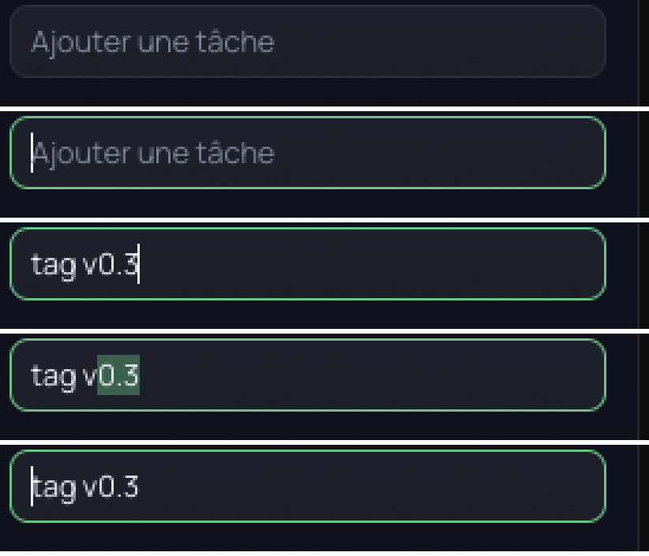

- **Placeholder:** shown, dimmed; it stays when focused and empty.
- **Caret:**
  - Correct at the end, after Home, and between letters.
  - Focused and empty, it sits at the text's origin, touching the left side of the placeholder's "A", as in GTK. It does not sit inside the letter, as in the first build.
  - iced has no setting to move the placeholder 1–2 px right, if we want air there.
- **Selection:** Shift+arrows select (the accent at 40 %). Typing and Enter worked. The task was added, the field emptied, and the keys were captured, so the bar's shortcuts did not fire.
- **Input method: not tested end to end.**
  - The first build's compositor advertises `zwp_text_input_manager_v3` but has no input-method protocol (`zwp_input_method_v2`). It never sends `text_input.enter` to a layer surface; `WAYLAND_DEBUG` shows only `set_content_type`, never `enter` or `enable`.
  - On the client side, layershellev enables text-input-v3 when it gets `enter`, and sends the cursor rectangle. It turns `preedit_string`/`commit_string` into iced's `Ime::Preedit`/`Commit`, and iced 0.14's `text_input` shows a preedit.
  - Testing it needs smithay's `TextInputManagerState` and `InputMethodManagerState` in the v2 compositor, keyboard focus on layer surfaces, and an input method (fcitx5) in the VM.

**Go** for caret, selection and placeholder. **IME unproven**, blocked by the compositor, not by iced.

## 4. The halo and the form switch

**What:**

- Everything uses iced 0.14's `Animation` (lilt). The spec's curves are `Easing::Custom(fn)`, with a small CSS cubic-bezier solver: (0.3, 0.6, 0.3, 1) for the wave and (0.2, 0.9, 0.25, 1.08) for the form, overshoot included.
- **Wave:**
  - A band 40 % of the bar's height, the state's colour at 38 %, from translateY(−70 %) to (260 %), as the prototype's `hpSweep`, in 600 ms.
  - It is drawn in a canvas as a gradient fill of the bar's rounded rectangle: iced clips children only to rectangles.
- **Glow:**
  - The border goes to the colour at 85 %, and an outer shadow of 34 px at 45 % is added. They fade in over 600 ms and out over 500 ms.
  - The inner glow (22 px at 18 %) is eleven rings in the canvas, because iced has no inset shadow.
- **Form switch:**
  - The width animates 196 ↔ 56 in 240 ms. The contents cross-fade in 120 ms from 60 ms, by threading an alpha through every colour: iced has no group opacity.
  - It is triggered by `b`, or by a click on the 8 px edge strip plus the bar's first 6 px.
- **Exclusive zone and input region:** both change at the start of the switch. The surface keeps its full width meanwhile, so it is never resized per frame.

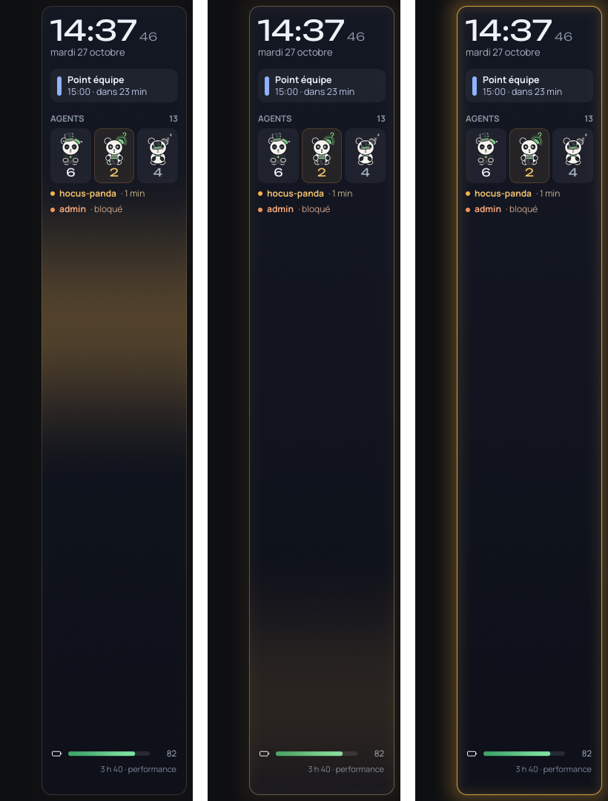

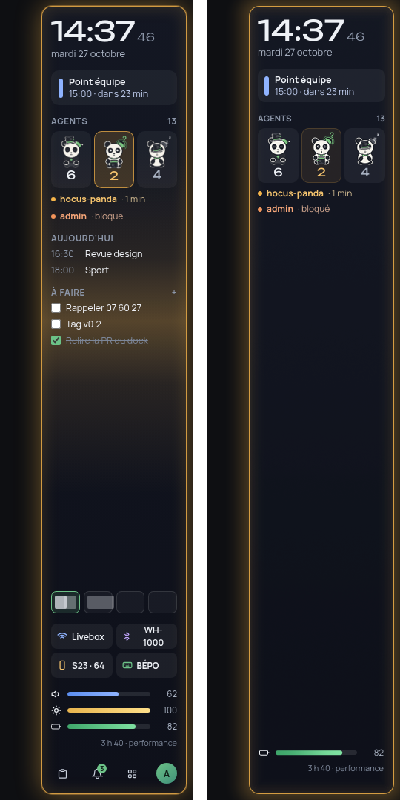

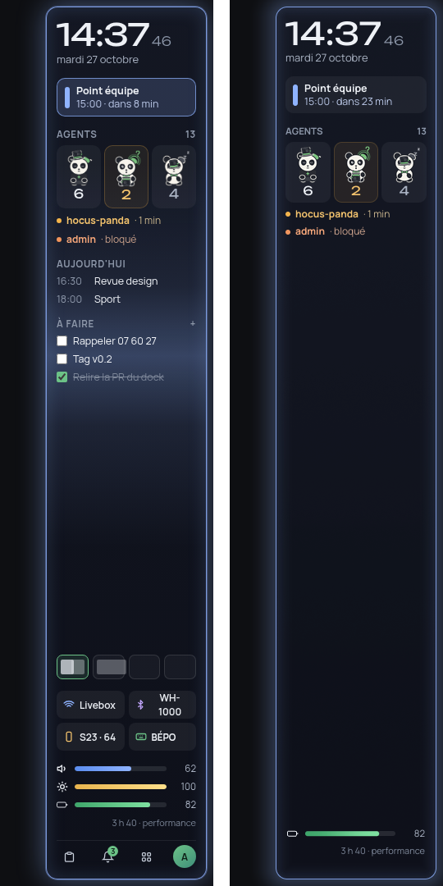

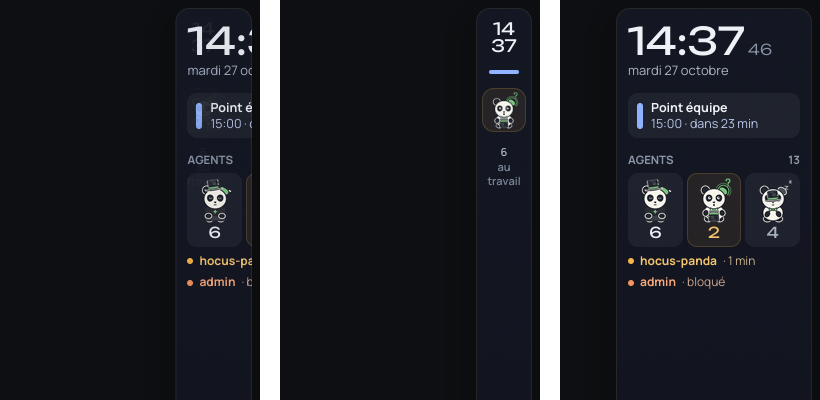

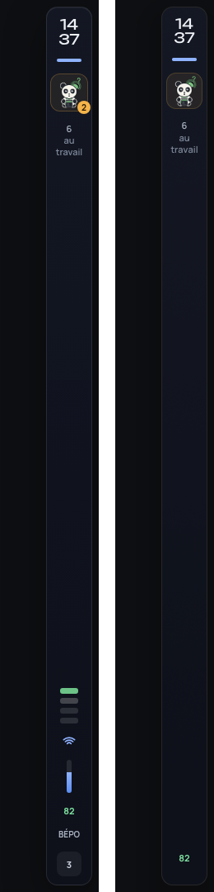

**The glow against the mockup:**

| Distance from the bar's edge | 1 px | 5 px | 10 px | 20 px | 30 px |
|---|---|---|---|---|---|
| Mockup, outside | (128,95,45) | (54,44,27) | (43,36,24) | (26,24,21) | (17,17,18) |
| iced, outside | (65,52,30) | (55,45,28) | (45,37,26) | (26,23,21) | (15,16,18) |

The glow matches except for its first pixel, where the mockup's 1 px spread ring (`0 0 0 1px`) is missing. Inside, at y = 900, it is 34/31/27/19 in the mockup against 39/35/27/19 in iced.

The mockup's static "agent" board also shows a sweep band in mid-run; in iced the wave only shows while it runs.

**Frames and CPU** (release build, headless, wgpu on lavapipe):

| Animation | Frames | Mean interval | Max interval |
|---|---|---|---|
| Wave and glow in (600 ms) | 29 | 22.3 ms | 26.6–31 ms (the first frame after the trigger) |
| Glow out (500 ms) | 25–26 | 21–22 ms | 25 ms |
| Form to mini (240 ms) | 14 | 20.7 ms | 23.2 ms |
| Form to full (240 ms) | 14 | 20.4 ms | 21.4 ms |

- **From frame callback to commit:** 0 ms median. The client's next frame was always ready before the compositor asked for it. The ~21 ms cadence is the headless backend's timer (16.7 ms after each change) plus its own render, not the bar.
- **Nested, still on lavapipe:** the bar kept up with the host's rate, at 6.8 ms between frames.
- **CPU during 10 waves back to back (6 s):** 12.5 s in total. 12.1 s of that is lavapipe's 22 threads; the bar's own threads (layout, canvas tessellation, iced) took 0.36 s, about 6 % of a core.
- **CPU during 10 form switches (3 s):** 3.1 s.
- **tiny-skia:** 2.5 s for the 10 waves, at about 34 frames a second.
- **What the API took to get right:**
  1. A `stack` draws its layers clipped to its bounds, so the outer glow was cut off until the shadow moved to a container around the stack.
  2. iced shrinks a fixed-width child to its parent, so the full content reflowed while the bar narrowed: the date wrapped and the tiles squeezed. A horizontal `scrollable` with a hidden scrollbar is the only stock widget that lets a child be wider than itself, clipped.

**API go:** the durations and curves are exact. **Smoothness at the refresh rate is not proven.** On a GPU the client's cost should be a fraction of lavapipe's, but nobody measured it. With software rendering it costs 2 cores for a wave, which would be a no-go on a laptop.

## 5. Restart

The bar was killed with foot open and maximized, then restarted 300 ms later. Its reappearance was detected by polling screenshots for the meeting card's blue pixel (`scripts/restart.py`).

| Build, signal | Back on screen (from exec) | The bar's own first draw |
|---|---|---|
| release, SIGKILL ×8 | 289–331 ms | 220–252 ms |
| debug, SIGTERM ×3 | 331–389 ms | 231–296 ms |
| tiny-skia | — | 10 ms |

- **Where the time goes:** most of the ~230 ms is wgpu's start: Vulkan instance and adapter enumeration, which loads the Intel, NVIDIA and lavapipe drivers. iced itself starts in about 10 ms, as tiny-skia shows.
- **Windows stay:** foot kept its id and state.
- **But they jump:** while the bar is down, its exclusive zone goes, and the maximized foot grows from 1716 to 1920 px wide, then shrinks back. Decision 1 wants the compositor to keep the bar's space reserved while the shell is down; the first build does not.
- **Exclusive zone:** the spike asked for 204 px (8 + 196). Windows then touch the bar, while the spec wants 8 px between them. Who adds that gap, the compositor or the zone, is to settle.

**Go:** well under the 2 s target.

## 6. Accessibility

- **No tree at all.** iced 0.14 exposes nothing to screen readers. No `accesskit` crate is anywhere in the spike's 423 dependencies, and none of iced's 0.14 crates nor iced_layershell mention it.
- **Not checked live.** Orca, accerciser and pyatspi are not installed here, and I did not install them. With no AccessKit code in the client, there would be nothing to see.
- **Upstream status:**
  - Accessibility has been an open question for iced for years ([#552](https://github.com/iced-rs/iced/issues/552), [#282](https://github.com/iced-rs/iced/issues/282)), and is not on the roadmap file.
  - System76's fork of iced, used by COSMIC, has an AccessKit integration ([Pop!_OS post](https://old.lemmy.dbzer0.com/post/220483); [COSMIC alpha 3](https://system76.com/blog/post/cosmic-alpha-3)). iced_layershell targets upstream iced, not that fork.

**Cost of adding it:**

- **Our own tree, recommended.** `accesskit_unix` 0.24.1 (MIT OR Apache-2.0) speaks AT-SPI over D-Bus by itself; it does not need winit.
  - The shell builds an `accesskit::TreeUpdate` from its own model, which it already knows: each item's role, name ("2 agents t'attendent", as the mockup's `aria-label`s), state, and the bounds it lays out.
  - It turns AccessKit actions (focus, default action) into messages.
  - About **3–5 days** for the bar and its popovers, then a little per new widget.
  - The text field's caret and selection are not exposed by iced's `text_input` state, so the field would be announced by name and value only, without caret tracking.
  - The session also needs the accessibility bus (`org.a11y.Bus`) running and reachable by the shell. The first build already finds it, to read applications' trees for agents.
- **The fork, not recommended.** Moving to System76's iced fork means forking iced_layershell too, then maintaining both against two upstreams.
- **Waiting for upstream:** no date.

Keyboard access (spec 11) is app-level and works in the spike: Tab cycles a focus ring, Enter acts, Esc closes.

**No-go as is; the cost is known** (about a week, our own code).

## 7. Blur behind the bar

Not implemented, as asked. This is from reading the first build and the protocols.

- **How the first build blurred its panels** (`crates/hocus-compositor/src/blur.rs` at `v0-first-build`):
  - A dual Kawase blur: n halvings from the reach (`levels()`, 1 to 6), 5-tap down passes and 8-tap up passes (`shaders/blur_down.frag`, `blur_up.frag`). The result is half resolution, upscaled when drawn.
  - GLES only: under pixman, the panels are solid.
  - To get what is behind a panel, it builds the output's scene a second time without what is in front of the pane. That goes into a per-(output, pane) texture covering the pane plus its reach. Each texture has its own `OutputDamageTracker`, and the blur is redone only when what is behind changes.
  - It never blurred a client's layer surfaces, only its own panels and window rules.
  - `levels`, the passes, both shaders, the glass element and the scenarios are reusable as is: our MIT code. It needs a saturation step (×1.35) and a pane kind for layer surfaces.
- **Protocol:** `ext-background-effect-v1`.
  - It is staging since wayland-protocols 1.45; GNOME's Mutter supports it too.
  - Per surface it offers `set_blur_region(wl_region)`, double-buffered, plus a `capabilities` event: the compositor can say "no blur" under pixman.
  - It carries no corner radius, so the compositor applies the theme's 14 px.
  - Bindings exist in `wayland-protocols` 0.32.13 (`ext::background_effect::v1`, feature `staging`), which smithay 0.7 already enables. smithay has no handler for it, so we write the global and the per-surface state.
  - KDE's `org_kde_kwin_blur` would need `wayland-protocols-plasma`: no reason to prefer it.
- **Where it goes in the renderer:** split `layer_elements` per surface. A blurred layer surface gets its glass element pushed behind its own elements, above the windows and the bottom and background layers. Damage then follows the first build's scheme.
- **Client side:** iced_layershell never hands the app its `wl_surface`, so asking for the effect needs a small patch to it. The alternative is compositor policy: blur the bar's namespace with the theme's radius, which is fine since both sides are ours.
- **Cost estimate (not measured):**
  - per re-blur at 1×: about 0.28 Mpx sampled, well under 0.1 ms on a GPU;
  - at 2×: about 1.1 Mpx, 0.1–0.3 ms;
  - nothing while what is behind stays still.
- **Effort:** about 4–6 days in the compositor (protocol 1, scene 1–1.5, region, corners and saturation 0.5–1, scenarios 1–1.5), and 1–2 days on the client.
- **In the VM** (virtio GPU without 3D, pixman): no blur. The bar must fall back to its opaque background, which the spec already asks for with "reduce transparency".

**Not tested on the maintainer's GPU or in the VM; it is compositor work whichever toolkit we pick.**

## Other findings

- **iced_layershell's dependencies broke the build on their own.** 0.19.1 failed to compile: its `iced_exdevtools` matches exhaustively on a winit-core enum. A semver-compatible prerelease, winit-core 0.31.0-**beta.4**, made that enum non-exhaustive. The fix was pinning `winit-core` and `winit-common` to beta.2 in `Cargo.lock`. Prerelease dependencies on a single-maintainer crate are a real risk: vendor it, or keep the lock file strict.
- **The fallback renderer has no transparency.** iced falls back to tiny-skia when wgpu cannot start, and on Wayland tiny-skia presents opaque buffers (softbuffer uses XRGB). The glow's room turns black and the glow opaque amber. A machine where wgpu fails would get a broken-looking bar: it needs a fix (softbuffer with ARGB) or an explicit opaque mode.

  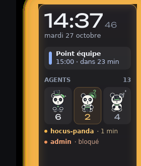
- **`cargo deny`:** licenses ok, bans ok, sources ok; **advisories fail on one item.**
  - That item is `ttf-parser` 0.25.1, flagged unmaintained (RUSTSEC-2026-0192). It comes through `fontdb` → `cosmic-text` 0.15, the core of iced 0.14's text, so it cannot be removed. Whether to ignore it with a reason in `deny.toml` is the maintainer's call; I did not add the ignore.
  - Three `zbus` sub-crates were also flagged unmaintained. They came from iced_layershell's default theme detection (`mundy`, over the session bus), and are gone with `default-features = false`.
- **Fonts:** Unbounded and Manrope come from google/fonts, under OFL-1.1, with no Reserved Font Name, so the static Manrope instances may keep their name. Their `OFL.txt` files sit next to them in `assets/`. OFL-1.1 is already on the allow list of decision 0002.
- **Pandas:** the deck's transparent PNGs, plus the pre-scaled copies.

## Recommendation

**iced, conditionally.**

**Where it won:**

- **The look.** After the three fixes in point 1, the bar is close to the board at 100 %. The remaining differences (letter-spacing, baselines, ellipsis) are text-layout features we can live without for a first slice, or add later in a few widgets of our own.
- **The behaviour.** The popover logic, the text field, the Animation API with custom curves, and a restart in 0.3 s all held up.
- **Fit.** Our styles go everywhere, as the tech choices wanted. None of the first build's defects showed up: no menus closing on the way, no caret inside the placeholder, no hover lost.

**What it costs, and the risks:**

1. **Performance on a GPU is unmeasured.** In software, an animation costs 2 cores and the process 300 MB. Before the first slice, run `bar-spike` on the maintainer's machine and in the VM with a dmabuf-capable compositor. That means v2's, or the first build on its tty backend, or anvil if building it is allowed. Count frames over budget and CPU with `scripts/threads.py`. If wgpu stays heavy, tiny-skia is about 1 % CPU at rest and 18 MB, but only once its transparency is fixed.
2. **Accessibility is ours to build:** about a week, with a text field read by name and value only. egui would give this for free, which is egui's one strong argument.
3. **iced_layershell has one maintainer and prerelease winit dependencies,** and it needs a patch for the blur request. Pin it, vendor it if needed. The fallback is to write our own thin layer-shell runner over iced's `iced_runtime`, which is what iced_layershell is.
4. **iced's API churns between releases** (0.13 → 0.14 renamed a lot). Stay on one minor version per slice.
5. **iced is missing a few things we will want:**
   - letter-spacing, ellipsis and baseline alignment;
   - group opacity, inset shadows and rounded clipping;
   - keyboard focus for buttons.

   Each has a workaround in the spike. Together they are the "few widgets of our own" the tech choices planned.
6. **Compositor work the shell cannot do for itself:**
   - give the keyboard back to the bar after a popover;
   - keep the bar's space while the shell restarts;
   - offer linux-dmabuf in every backend;
   - text-input and input-method for layer surfaces;
   - background blur.

   These are needed whatever the toolkit, and belong in the compositor's first slices.

The egui fallback is not needed for points 2 and 3, which passed. It would only be worth measuring if point 4 fails on the GPU, or if accessibility is required in v1 and a week of our own AccessKit work is judged too much.

## Not tested

- GPU rendering, frame budgets at the refresh rate, and memory on a GPU. The compositor offers no dmabuf, and building anvil was refused by the permission system.
- An input method, end to end.
- A screen reader. There is no tree to read; Orca and accerciser are not installed, and I did not ask to install them.
- Blur: estimated only.
- A 2× output, and an output too short for the full form.
- The user's machine and the VM.
- Hover-to-open popovers (mini form): the spike opens on click only.

## Reproducing

```sh
# fonts/pandas are in crates/bar-spike/assets; build:
cargo build --release -p bar-spike
# a headless first-build compositor in a fresh environment (V1_BIN: its binaries)
D=$(V1_BIN=… crates/bar-spike/scripts/up.sh)
crates/bar-spike/scripts/client.sh "$D" foot
BAR_BIN=target/release/bar-spike crates/bar-spike/scripts/bar.sh "$D" BAR_TRACE=1 BAR_FAKE_TIME=14:37:46
V1_BIN=… python3 crates/bar-spike/scripts/drive.py "$D" aim   # also escape-up, return, pause, window, text, halo, cpu
python3 crates/bar-spike/scripts/frames.py "$D/bar.log"
```

Environment knobs of the bar:

- `BAR_TRACE=1` logs draws and decisions.
- `BAR_FAKE_TIME=14:37:46` freezes the clock as on the board.
- `BAR_HALO=agent|meeting` starts in that halo state, and `BAR_FORM=mini` starts in the mini form.
- `BAR_PANDA=raw` uses the full-size pandas.
- `ICED_BACKEND=tiny-skia` uses iced's CPU renderer.
